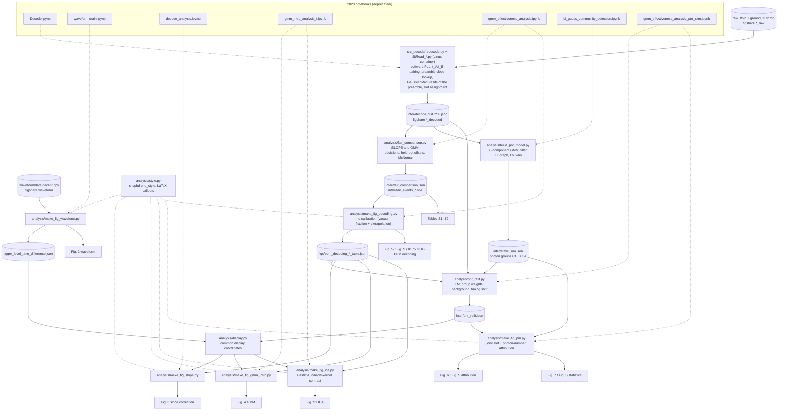

# ppm_pnr

Analysis code for the manuscript

> A. Mueller, B. Korzh, E. Wollman, A. D. Beyer, I. Craiciu, M. D. Shaw, M. Spiropulu,
> **"Data Recovery and Pulse Position Modulation with a Photon Number Resolving SNSPD"**,
> Optics Express (submitted). DOI: *to be added*

A differential SNSPD is read out at two trigger levels (t_A, t_B). The pair (t_A, t_B) carries both the
arrival time and the photon number of each detection. This repository decodes 2048-ary pulse-position
modulation (PPM) at 20 GHz (50 ps slots) and 1024-ary PPM at 10.75 GHz (93 ps slots) with a slope correction
("SLOPE") and with a Gaussian-mixture model of the detector response ("GMM"), and it extracts photon-number
statistics from the same detections.

The repository holds **code only**. The data are on figshare, one item per subset, and
`figshare_download.py` puts them where the scripts expect them (see [Data](#data)).

## Quick start

```sh
# 1. environment (uv: https://docs.astral.sh/uv/). Python 3.12 is installed by uv if needed.
uv sync                                   # analysis + notebook dependencies
#   uv sync --no-default-groups           # scripts only, no Jupyter

# 2. data: the decoded subsets are enough for every figure (~140 MB of zips)
uv run python figshare_download.py --dataset ppm_20ghz_decoded ppm_10ghz_decoded waveform

# 3. figures
scripts/run_all.sh                 # every figure of the paper and supplement + SLOPE/GMM tables (~10 min)
scripts/run_all.sh --notebooks     # also execute the walk-through notebooks in notebooks/
```

Outputs go to `ppm_20ghz/figs/`, `ppm_10ghz/figs/`, `waveform/figs/` and the `inter/` folders.

## Data

| key (`--dataset`) | content | zip | unpacked | DOI |
|---|---|---|---|---|
| `ppm_20ghz_decoded` | 20 GHz decode files (16-48 dB), photon-number model, PNR refit, 2023 alignment files | 27 MB | 148 MB | 10.6084/m9.figshare.34741485 |
| `ppm_10ghz_decoded` | 10.75 GHz decode files (18-44 dB, 42 dB = corrected re-decode), photon-number model, PNR refit | 114 MB | 512 MB | 10.6084/m9.figshare.34741488 |
| `waveform` | trigger-level scan of the detector pulse (Fig. 2), t_B - t_A delay | 0.1 MB | 3 MB | 10.6084/m9.figshare.34741491 |
| `ppm_20ghz_raw` | raw Swabian Time Tagger files (16-50 dB) + AWG ground truth | 2.0 GB | 2.9 GB | 10.6084/m9.figshare.34741494 |
| `ppm_10ghz_raw` | raw Swabian Time Tagger files (18-44 dB) + AWG ground truth | 1.3 GB | 2.1 GB | 10.6084/m9.figshare.34741497 |

All five items are published in one figshare collection, DOI [10.6084/m9.figshare.c.8789040](https://doi.org/10.6084/m9.figshare.c.8789040)
(also the [ppm_pnr_datasets](https://figshare.com/projects/ppm_pnr_datasets/283395) project). Cite the collection DOI for the data as a whole.

```sh
uv run python figshare_download.py --list                         # sizes, DOIs, what is already here
uv run python figshare_download.py --dataset ppm_10ghz_decoded    # any subset
uv run python figshare_download.py --all                          # everything (3.4 GB of zips)
uv run python figshare_download.py                                # interactive menu
```

Each zip contains paths relative to the repository root (for example
`ppm_20ghz/inter/decode_20GHz24.0.json`) and is unpacked in place. The download is checked against the md5
that figshare computed on upload, and every unpacked file against the dataset's `MANIFEST_<key>.txt`.
Datasets that are already present are skipped (`--force` downloads again, `--verify` re-checks md5s).
The raw data are only needed to re-run the decoder.

All dataset metadata (article ids, DOIs, sizes, file lists) are in `figshare_metadata.yaml`.

## Layout

```
analysis/                  dataset-agnostic scripts, all take --dataset 10|20
  datasets.py              per-dataset settings (attenuations, slot width, GMM index, panels) -- edit here
  load_schema.py           pydantic-v2 loaders for the decode files
  fair_comparison.py       SLOPE vs GMM with cross-validated offsets + McNemar test (supplemental tables)
  make_fig_decoding.py     decoding-performance figure (Fig. 5; 10.75 GHz: supplement)
  build_pnr_model.py       photon-number model (groups of GMM components) from a preamble fit
  pnr_refit.py             photon-number attribution: fitted cluster weights + common-mode timing offset (EM)
  make_fig_pnr.py          photon-number attribution and statistics figures (Figs. 6, 7; 10.75 GHz: supplement)
  display.py               common (t_A, t_B) display coordinates for all scatter/histogram panels
  make_fig_waveform.py     Fig. 2 (detector waveform, trigger delay)
  make_fig_slope.py        Fig. 3 (slope-based correction)
  make_fig_gmm_intro.py    Fig. 4 (GMM of the two-threshold response, slot decision regions)
  make_fig_ica.py          Fig. S1 (ICA projection)
notebooks/                 walk-throughs that import analysis/ and plot intermediate steps
  decoding_comparison.ipynb    offset scans, held-out calibration, McNemar test, all attenuations
  photon_number_model.ipynb    KL graph, Louvain stability, fitted vs 2023 offsets, effect of the Poisson prior
  ica_contrast.ipynb           why FastICA's default contrast misses the photon-number axis, and the narrow-kernel fix
ppm_20ghz/
  src_decode/              decoder: raw .ttbin -> inter/decode_20GHz{dB}.0.json (Linux container, see below)
  deprecated/              the original 2023 notebooks and helper modules (each says what replaced it), outputs stripped
  data/  inter/  figs/     filled by figshare_download.py / the scripts (git-ignored)
ppm_10ghz/
  src_decode/  (+ docker/) decoder and the Linux container used for both datasets
  deprecated/              superseded 2023 notebooks
  data/  inter/  figs/
waveform/
  deprecated/main.ipynb    the original Fig. 2 notebook
  data/  figs/
scripts/run_all.sh         regenerate everything from the decoded data
figshare_download.py       data downloader (users)
figshare_metadata.yaml     figshare ids, DOIs, sizes, file lists of every dataset
tools/                     maintainer tools: package_datasets.py (build the zips), figshare_upload.py (upload)
```

Run the scripts from the repository root as modules (`uv run python -m analysis.<name> --dataset 20`), or
import them (`from analysis.fair_comparison import analyze`); nothing runs at import time.

## Figures

| Figure | Made by | Inputs |
|---|---|---|
| Fig. 1 (setup) | not code (drawn in Blender/Illustrator) | |
| Fig. 2 waveform | `python -m analysis.make_fig_waveform` | `waveform` |
| Fig. 3 slope correction | `python -m analysis.make_fig_slope` | `ppm_20ghz_decoded` (22, 26, 30 dB), Fig. 5 table, `pnr_refit.json` |
| Fig. 4 GMM introduction | `python -m analysis.make_fig_gmm_intro` | `ppm_20ghz_decoded` (26, 36 dB), Fig. 5 table, `pnr_refit.json` |
| Fig. 5 PPM decoding | `python -m analysis.make_fig_decoding --dataset 20` | `ppm_20ghz_decoded` |
| Fig. 6 photon-number attribution | `python -m analysis.make_fig_pnr --dataset 20` | `static_sim.json`, `pnr_refit.json`, Fig. 5 table |
| Fig. 7 photon statistics | `python -m analysis.make_fig_pnr --dataset 20` | as Fig. 6 |
| Fig. S1 ICA | `python -m analysis.make_fig_ica` (FastICA with a narrow-kernel contrast; see `notebooks/ica_contrast.ipynb`) | `ppm_20ghz_decoded` (24 dB), Fig. 5 table |
| Tables S (SLOPE vs GMM, 20 and 10.75 GHz) | `python -m analysis.fair_comparison --dataset 20` / `10` -> `inter/fair_comparison.json`; also `figs/ppm_decoding_<tag>_table.json` | decoded data |
| 10.75 GHz supplemental figures | `make_fig_decoding` / `make_fig_pnr --dataset 10` | `ppm_10ghz_decoded` |

`pnr_refit.json` is regenerated by `python -m analysis.pnr_refit --dataset 20|10` (run_all.sh does this; the
downloaded copy is identical). The 20 GHz scripts write `pnr_*_20GHz_light.pdf`; the manuscript includes
them as `pnr_resolved_arrival_time_groupings_light.pdf` and `pnr_stats_light.pdf`.

All (t_A, t_B) panels share the display coordinates of `analysis/display.py`: the fitted common-mode offset
of each attenuation is removed so the 1-photon group sits at t_A = 0, and (20 GHz) t_B is offset so that the
1-photon t_B - t_A equals the 548.9 ps trigger delay measured from the waveform. The `offset_correction_*.json`
files in `ppm_20ghz_decoded` are the hand-derived 2023 alignment vectors; they are used only by
`notebooks/photon_number_model.ipynb` for comparison.

## Pipeline

Data flow from the raw time tags to the figures. Dashed arrows: the 2023 notebook (now in `*/deprecated/`)
that each script replaces.



`scripts/run_all.sh` runs the analysis steps in this order. The notebooks in `notebooks/` are read-only
walk-throughs that import the same functions.

## Decoding the raw data (optional)

The decoder reads the `.ttbin` files with the Swabian Time Tagger API, which has no macOS build, so it runs
in a Linux container. One image serves both datasets: `ppm_10ghz/src_decode/docker/`
(Python 3.11, `Swabian-TimeTagger` 2.22.6 from PyPI, numpy 1.26.4, scikit-learn 1.2.2).

```sh
uv run python figshare_download.py --dataset ppm_20ghz_raw ppm_10ghz_raw
colima start --cpu 6 --memory 16 --mount "$PWD:w"        # macOS only (brew install colima docker)
docker build -t ppm-pnr-decode ppm_10ghz/src_decode/docker
docker run --rm -v "$PWD":/work -w /work/ppm_20ghz/src_decode ppm-pnr-decode python redecode.py --all
docker run --rm -v "$PWD":/work -w /work/ppm_10ghz/src_decode ppm-pnr-decode python redecode.py --all
```

Outputs go to `<dataset>/inter/redecode/`, so the downloaded files are not overwritten. With this image the
re-decode reproduces the published decode files event for event (all five repetitions, every field of every
frame); the stored GMM parameters agree to ~1e-8 relative (floating-point differences between platforms).
scikit-learn is pinned to 1.2.2 on purpose: later versions converge to slightly different GMM optima.
Details: `ppm_10ghz/src_decode/docker/README.md`.

## Environment

One uv environment (`pyproject.toml`, `uv.lock`, Python 3.12) for all analysis:
numpy >= 2.1 (2.0.x gives spurious matmul warnings with macOS Accelerate), scipy, scikit-learn, numba,
matplotlib, orjson, networkx, pillow, pydantic 2, pyyaml, requests, and `snsphd` (the author's plotting
style, used by every figure script through `analysis/style.py`); Jupyter in the default `notebooks` group;
bokeh and plotly in the optional `deprecated` group (only for the 2023 notebooks); `ruamel.yaml` and
`nbstripout` in the `tools` group. A TeX installation with `latex` and `dvipng` (for example TinyTeX, found
automatically in `~/Library/TinyTeX`) is optional: with it, the ket and mu callouts in the figures are set in
LaTeX as in the paper; without it they fall back to bold mathtext. The 2023 code used pydantic 1.9; `analysis/load_schema.py` is the pydantic-v2 port
(`@validator` -> annotated numpy field type, `class Config` -> `model_config`).

The analysis results do not depend on the package versions beyond floating-point rounding: with the locked
environment, every count in the SLOPE/GMM tables and the photon-number fits reproduces the published values
exactly, and the floating-point values agree to better than 1e-10 relative.

## What is not here

- the 2023 notebooks whose methods are replaced by `analysis/` are in `*/deprecated/` (outputs stripped,
  code unchanged, not maintained). Among them `ppm_20ghz/deprecated/bi_gauss_community_detection.ipynb`
  made the published 20 GHz `static_sim.json`; `python -m analysis.build_pnr_model --dataset 20` rebuilds
  the same grouping deterministically. They
  need files that are not on figshare (`inter/output.json`, `inter/output_pnr.json`, ~285 MB, made by
  `deprecated/gmm_effectiveness_analysis*.ipynb` with `recompute=True`)
- the Bokeh/Plotly web visualisations (`www/`, published at https://sansseriff.github.io/ppm_20ghz/),
  old intermediate folders (`inter/old*`), the `testing/` raw files of the 20 GHz run, and Illustrator files

## License and citation

Code: MIT (`LICENSE`). Data: CC BY 4.0. Please cite the article (see `CITATION.cff`).
